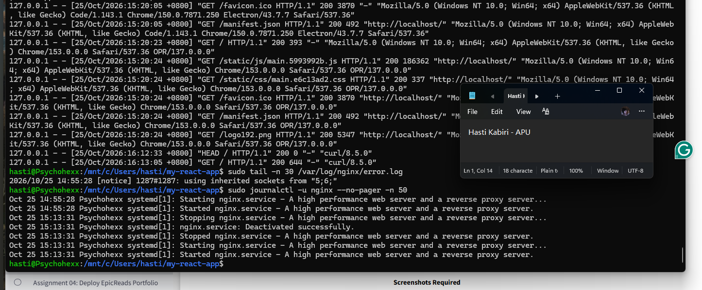
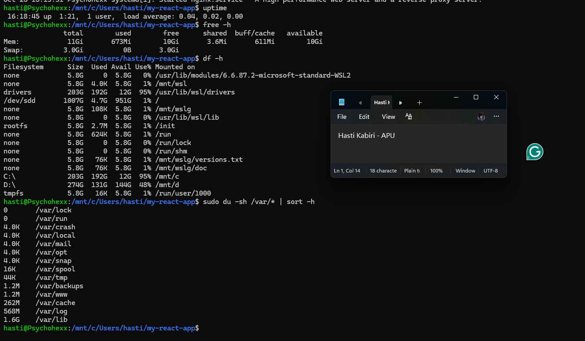
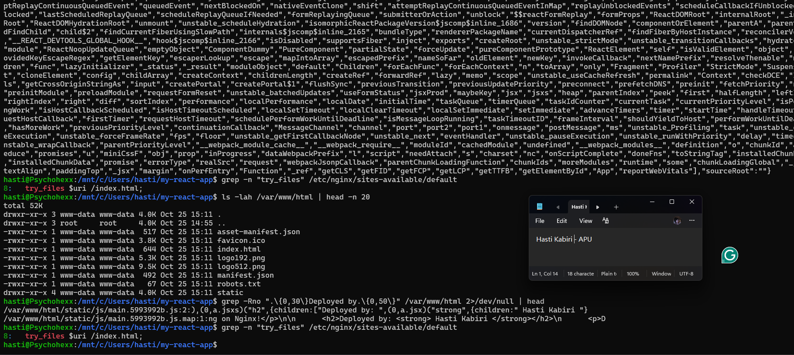
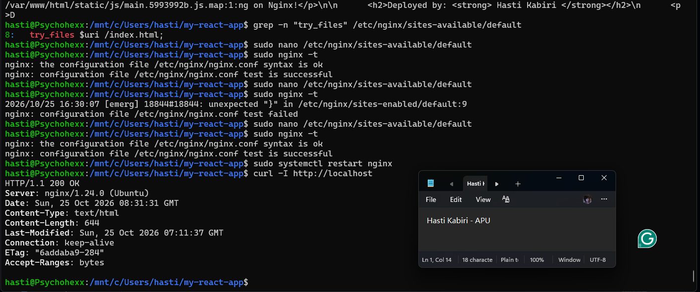
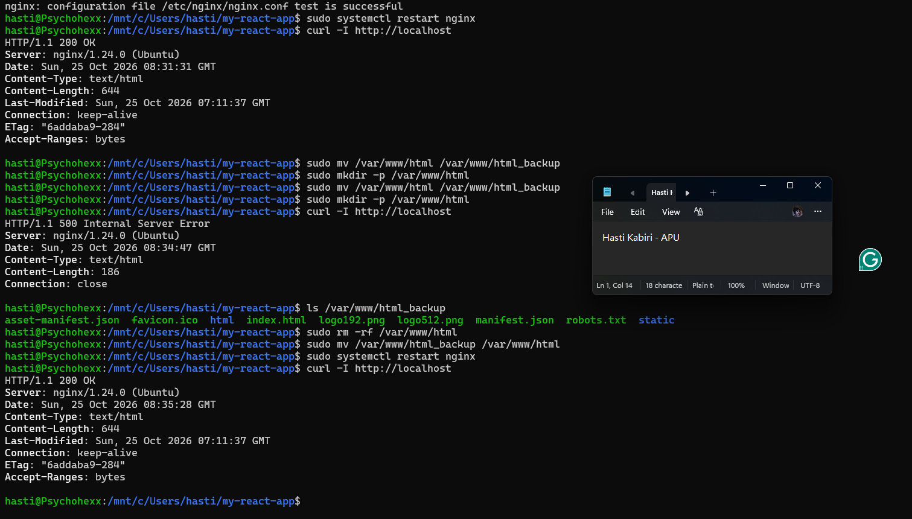

# Assignment 3 — Production Maintenance Drill (OPS Checklist)

Part of the DevOps Micro Internship (DMI) Cohort 3 with Agentic AI

---

## Purpose

In this assignment, you will treat your already deployed React application (on Ubuntu VM with Nginx) as a live production system. You will perform structured operational checks covering network validation, service health, log analysis, resource monitoring, configuration verification, and incident simulation with recovery — mirroring real on-call DevOps responsibilities.

---

# Task 1 — Server Access & Networking Validation

## Goal

Verify that the deployed React application is reachable from the browser and confirm basic network connectivity of the Ubuntu VM.

### Evidence

#### Screenshot 1 — Browser showing the React app with your Full Name visible on the UI

---

#### Screenshot 2 — Output of `ip a`

---

#### Screenshot 3 — Output of `sudo ss -tulpen`

---

#### Screenshot 4 — Output of `sudo ufw status`

---

### Notes

Answer the following in your own words:

**1. What proves Nginx is listening on 0.0.0.0:80?**

This line from sudo ss -tulpen output proves it:

tcp   LISTEN   0   511   0.0.0.0:80   0.0.0.0:*   users:(("nginx",pid=17661,fd=5), ...)

---

**2. What proves SSH is active on port 22?**

These lines from sudo ss -tulpen output prove it:

tcp   LISTEN   0   4096   0.0.0.0:22   0.0.0.0:*   users:(("sshd",pid=18557,fd=3),("systemd",pid=1,fd=153))
tcp   LISTEN   0   4096      [::]:22      [::]:*   users:(("sshd",pid=18557,fd=4),("systemd",pid=1,fd=154))

What each part shows:

Part: tcp
Meaning: It's a TCP socket, which is what SSH uses.
────────────────────────────────────────
Part: LISTEN
Meaning: It's waiting for incoming connections.
────────────────────────────────────────
Part: 0.0.0.0:22
Meaning: It's listening on port 22 on all IPv4
interfaces.
────────────────────────────────────────
Part: [::]:22
Meaning: It's also listening on port 22 on all IPv6
interfaces.
────────────────────────────────────────
Part: users:(("sshd",pid=18557))
Meaning: The process that owns the socket is sshd, the
SSH server.
────────────────────────────────────────
Part: systemd / ssh.socket
Meaning: systemd opened the socket for SSH (socket
activation), which is normal on recent Ubuntu.

Short answer: the output of sudo ss -tulpen shows TCP sockets in the LISTEN state on 0.0.0.0:22 and [::]:22, owned by the sshd process.

---

**3. Did you find any unexpected open ports? Explain briefly.**

No, there were no unexpected open ports exposed to the network. The only ports listening on all interfaces (0.0.0.0 / [::]) are the expected ones:

- 80/tcp: nginx, serving the React app
- 22/tcp: sshd, for remote SSH access

The other listening ports are bound only to local or loopback addresses, so other machines can't reach them:

- 53 (tcp/udp) on 127.0.0.53 / 127.0.0.54: systemd-resolved, the local DNS resolver
- 53 on 10.255.255.254: WSL's internal DNS forwarder
- 323/udp on 127.0.0.1 / [::1]: the NTP time sync service (chrony), local only
- 38379/tcp on 127.0.0.1: containerd (the container runtime used by Docker), local only

---

# Task 2 — Service Health & Systemd Validation (Nginx)

## Goal

Verify that Nginx is properly installed, running, enabled at boot, and safely configured.

### Evidence

#### Screenshot 1 — Output of `systemctl status nginx --no-pager`

---

#### Screenshot 2 — Output of `sudo nginx -t`

---

#### Screenshot 3 — Output of `sudo ss -lptn '( sport = :80 )'`

---

### Notes

Answer the following in your own words:

**1. What happens if Nginx fails to restart in production?**

If nginx fails to restart in production, the website goes down. Users get "connection refused" or timeout errors, because nothing is listening on port 80 anymore.

What happens:
- The site is down. A restart stops the old process first. If the new one fails to start (for example because of a config syntax error or because port 80 is already in use), no process is serving traffic.
- Users and the business are affected. Lost traffic, failed requests and possible revenue loss, and monitoring alerts start firing.

---

**2. What's your basic rollback plan?**

My basic rollback plan is to keep a backup of the last working version, and to restore it if a change breaks the site.

1. Before making changes, take backups:
sudo cp /etc/nginx/sites-available/default /etc/nginx/sites-available/default.bak
sudo cp -r /var/www/html /var/www/html.bak

2. After the change, verify:
sudo nginx -t
sudo systemctl reload nginx
systemctl is-active nginx
curl -I http://localhost      # should return HTTP 200

3. If anything fails, roll back:
# Restore the nginx config
sudo cp /etc/nginx/sites-available/default.bak /etc/nginx/sites-available/default

# Restore the previous app build
sudo rm -rf /var/www/html
sudo cp -r /var/www/html.bak /var/www/html

# Test and restart
sudo nginx -t
sudo systemctl restart nginx
systemctl status nginx --no-pager

4. Confirm the site works again in the browser and with curl -I http://localhost. Then check journalctl -u nginx and /var/log/nginx/error.log to find out what went wrong before trying the change again.

---

# Task 3 — Logs & Request Trace

## Goal

Verify real traffic flow and analyze logs to understand system behavior and errors.

### Evidence

#### Screenshot 1 — Output of `sudo tail -n 30 /var/log/nginx/access.log`

---

#### Screenshot 2 — Output of `sudo tail -n 30 /var/log/nginx/error.log`

---

#### Screenshot 3 — Output of `sudo journalctl -u nginx --no-pager -n 50`

---

### Notes

Answer the following in your own words:

**1. Were there any errors in the logs?**

- If yes, mention 1–2 example error lines from the logs and explain what each one means in simple terms.
- If no, explain what it means if the error log is empty or shows no recent errors during your check.

No, there were no errors in the logs.

- Error log (/var/log/nginx/error.log): the only entry was
2026/10/25 14:55:28 [notice] 1287#1287: using inherited sockets from "5;6;"
  This is a [notice], not an error. It's an informational message saying nginx reused its existing listening sockets during startup, which is normal. There were no [error], [crit] or [emerg] entries.
- Service log (journalctl -u nginx): nginx started at 14:55:28 and was cleanly restarted at 15:13:31 ("Deactivated successfully", then "Started"). There were no failures.
- Access log (/var/log/nginx/access.log): every request returned HTTP 200. That includes the main page (/), the JavaScript and CSS bundles, favicon.ico, manifest.json and logo192.png, from both browsers and curl. There were no 404 or 500 responses.

---

**2. If there were no errors, what does that indicate about the system?**

 No errors means nginx is configured correctly, running stably, and serving all the React app files successfully. The system is healthy, but logs should still be monitored over time.

---

**3. Based on the access logs, were your curl requests visible in the log entries? What does that prove about traffic flow?**

Yes. The curl requests appear in the access log with the user agent curl/8.5.0:

127.0.0.1 - - [25/Oct/2026:16:12:33 +0800] "HEAD / HTTP/1.1" 200 0 "-" "curl/8.5.0"
127.0.0.1 - - [25/Oct/2026:16:13:05 +0800] "GET / HTTP/1.1" 200 644 "-" "curl/8.5.0"

The HEAD request is from curl -I and the GET request is from curl -s. Both returned 200. The browser requests (Chrome and Opera) are also logged, including the JS, CSS, favicon and manifest files. This proves the full traffic flow works: the request reaches port 80, Nginx receives and handles it, serves the React files from /var/www/html, and logs every request with its status code.

---

# Task 4 — System Resource Health Check (Capacity Red Flags)

## Goal

Assess server capacity and detect potential performance or failure risks.

### Evidence

#### Screenshot 1 — Output of `uptime`

---

#### Screenshot 2 — Output of `free -h`

---

#### Screenshot 3 — Output of `df -h`

---

#### Screenshot 4 — Output of `sudo du -sh /var/* | sort -h`

---

### Notes

Answer the following in your own words:

**1. Which resource looks most critical right now? (CPU/load, memory, or disk) Explain why.**

 Disk. CPU load (0.02 on 20 cores) and memory (706 MB of 11 GB used, no swap) are healthy, but the C: drive holding the project is 95% full with only 12 GB left. Running out of disk space would break builds, installs and logging.

---

**2. What happens if disk becomes 100% full in a production server?**

A 100% full disk makes every write fail. Logs stop, services like nginx and databases crash or won't restart, deployments and updates fail with "No space left on device", and users get errors or downtime. Prevent it with disk monitoring and alerts, log rotation and regular cleanup.

---

# Task 5 — Configuration & Deployment Verification

## Goal

Ensure the correct React build is deployed and Nginx is serving it properly.

### Evidence

#### Screenshot 1 — Output of `ls -lah /var/www/html | head -n 20`

---

#### Screenshot 2 — Output of `grep -R "Deployed by" -n /var/www/html 2>/dev/null | head`

---

#### Screenshot 3 — Output of `grep -n "try_files" /etc/nginx/sites-available/default`

---

### Notes

Answer the following in your own words:

**1. How do you confirm that the correct version of the application is deployed?**

 I searched /var/www/html for a unique marker ("Deployed by: Hasti Kabiri") and found it in main.5993992b.js. I then confirmed with curl that nginx serves the HTML referencing that same file, with 200 OK and a recent Last-Modified time, and checked that the text appears in the browser.

---

# Task 6 — Nginx Configuration Failure Simulation

## Goal

Simulate a real-world Nginx misconfiguration and recover the service safely.

### Evidence

#### Screenshot 1 — Output of `sudo nginx -t` showing the syntax error (broken config)

---

#### Screenshot 2 — Output of `sudo nginx -t` showing syntax ok (fixed config)

---

#### Screenshot 3 — Output of `curl -I http://<public-ip>` confirming recovery (200 OK)

---

### Notes

Answer the following in your own words:

**1. What caused the configuration failure?**

 A missing semicolon at the end of try_files $uri /index.html caused a syntax error. nginx requires every directive to end with ;, so it hit the closing } unexpectedly and nginx -t failed with:

[emerg] unexpected "}" in /etc/nginx/sites-enabled/default:9

Testing before restarting kept the site from going down.

---

**2. How did you fix the issue?**

I opened the config again with sudo nano /etc/nginx/sites-available/default, added the semicolon back to the end of line 8 (try_files $uri /index.html;) and saved it. Then I ran sudo nginx -t, which showed "syntax is ok" and "test is successful", restarted Nginx with sudo systemctl restart nginx, and confirmed recovery with curl -I http://localhost, which returned HTTP/1.1 200 OK.

---

**3. How can you avoid this kind of issue in real production systems?**

Always run nginx -t before applying changes, use reload instead of restart, back up configs and keep them in Git, test in staging first, automate checks in CI/CD, and monitor the site after every change.

---

# Task 7 — Web Application Failure Simulation

## Goal

Simulate missing deployment content and recover the application safely.

### Evidence

#### Screenshot 1 — Output of `curl -I http://<public-ip>` showing failure (non-200 response)

---

#### Screenshot 2 — Output of `curl -I http://<public-ip>` confirming recovery (200 OK)

---

### Notes

Answer the following in your own words:

**1. What caused the application to break in this scenario?**

The React build files were moved out of /var/www/html, leaving an empty folder. nginx was still running but had no index.html to serve, so the request failed with a 500 error. This simulates a broken or incomplete deployment.

---

**2. How did you fix the issue and restore the application?**

I checked the backup, deleted the empty /var/www/html, moved /var/www/html_backup back to /var/www/html, restarted nginx, and confirmed with curl -I http://localhost that the site returned 200 OK again.

---

**3. What steps would you take to prevent this kind of issue in real production systems?**

Back up before every deployment, deploy to versioned release folders with a symlink for instant rollback, verify the build and automate deployments with CI/CD, run a health check (curl returning 200) after each deploy with automatic rollback if it fails, and monitor the site for errors.

---

# Task 8 — Security & Reliability Review

## Goal

Review and reflect on the security and reliability practices applied during this assignment.

### Security & Reliability Notes

Answer the following in your own words:

**1. Why is SSH key-based authentication more secure than sharing passwords?**

SSH key authentication is more secure because it utilizes a pair of keys instead of a password for user authentication purposes. While the user retains their private key, the public key is then stored on the server. Such a process makes possibilities for password theft and illegal access smaller.

---

**2. Why should only required ports be open on a production server?**

In decreasing the attack surface of the server. Every open port acts like a potential entry point for reaching the server. Limiting the number of open ports reduces the chances of unauthorized access and increases the safety of the server.

---

**3. Why is it important for Nginx to be enabled on boot?**

Nginx should be enabled at boot time in order to make sure that the web server is active every time the server is rebooted. Thus, the application being hosted remains available without anybody needing to start Nginx manually.

---

**4. What are the risks of sharing secrets, keys, or credentials publicly?**

The risks of disclosing secrets, keys, or credentials publicly consist in opening the doors to hackers. They will then be able to get access to servers, accounts, and sensitive content and exploit that information to steal whatever is valuable, alter applications, or generate unexpected charges. These credentials need to remain hidden and protected in a proper way.

---

**5. Why should cloud resources be stopped or terminated when they are no longer needed?**

Cloud resources should be stopped or deleted after they are no longer used in order to prevent high costs and risks. Some of the resources may keep incurring expenses even in case they were not used at all, and removing excessive resources helps organize and protect the cloud environment better.

---

# LinkedIn Post (Required)

## Evidence

#### LinkedIn Post URL

Paste your LinkedIn post URL here:

https://lnkd.in/p/gipUus7D

---

#### Screenshot — Published LinkedIn post

---

# Submission Instructions

- Add all required screenshots in your submission
- Full name must be visible in required screenshots
- Do not expose sensitive information (keys, passwords, account IDs)

---

# Completion Checklist

- [✅] Task 1: Screenshots (browser, ip a, ss -tulpen, ufw status) + Notes answered
- [✅] Task 2: Screenshots (nginx status, nginx -t, ss port 80) + Notes answered
- [✅] Task 3: Screenshots (access log, error log, journalctl) + Notes answered
- [✅] Task 4: Screenshots (uptime, free -h, df -h, du -sh) + Notes answered
- [✅] Task 5: Screenshots (ls html, grep deployed by, grep try_files) + Notes answered
- [✅] Task 6: Screenshots (nginx -t fail, nginx -t pass, curl recovery) + Notes answered
- [✅] Task 7: Screenshots (curl failure, curl recovery) + Notes answered
- [✅] Task 8: Security & Reliability Notes answered
- [✅] LinkedIn post published and URL submitted
- [✅] Full Name visible in all required screenshots
- [✅] No sensitive data exposed

---

## 📌 About DMI & CloudAdvisory

DevOps Micro Internship (DMI) is a project-based DevOps program run by Pravin Mishra (The CloudAdvisory) focused on real-world execution, systems thinking, and career readiness.

It helps learners build strong DevOps foundations with hands-on experience.

---

## 📌 Resources

- 🌐 DMI Official Website: https://dmi.pravinmishra.com?utm_source=github&utm_medium=readme  
- 🎓 University: https://university.pravinmishra.com?utm_source=github&utm_medium=readme  
- 💬 Discord Community: https://discord.pravinmishra.com?utm_source=github&utm_medium=readme  
- 📝 Blog: https://dmi.pravinmishra.com/blog?utm_source=github&utm_medium=readme  
- ▶️ YouTube Playlist: https://www.youtube.com/playlist?list=PLFeSNDtI4Cho  
- 🔗 Pravin Mishra (LinkedIn): https://www.linkedin.com/in/pravin-mishra-aws-trainer/  
- 🏢 CloudAdvisory (LinkedIn): https://www.linkedin.com/company/thecloudadvisory/

---

*This submission is part of DevOps Micro Internship (DMI) Cohort 3 — Agentic AI Track.*